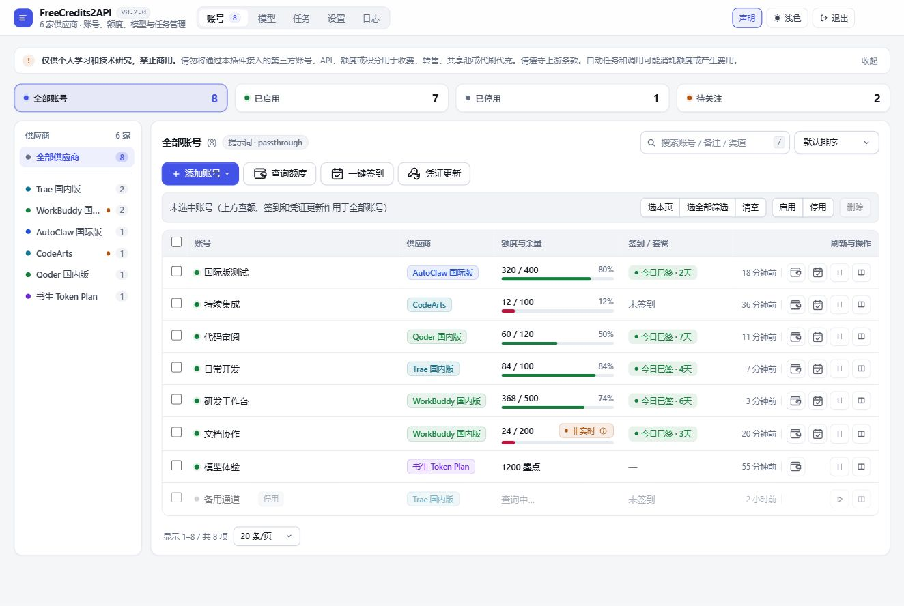

<div align="center">


# FreeCredits2API

[](https://go.dev/)
[](https://github.com/router-for-me/CLIProxyAPI)
[](LICENSE)

中文 | [English](README_EN.md)

</div>

FreeCredits2API 是面向 [CLIProxyAPI](https://github.com/router-for-me/CLIProxyAPI)（CPA）的多供应商接入插件，提供统一的账号、模型、额度与任务管理。插件以原生动态库形式运行，复用宿主的 API、鉴权和路由能力。

本项目基于 [cpa-freetier2api-plugin](https://github.com/Likhixang/cpa-freetier2api-plugin) 重新设计并独立维护。

> **仅供个人学习和技术研究，禁止商用。** 请勿将接入的第三方账号、API、额度、积分或活动权益用于商业收费、转售、有偿代搭、代刷代充或公开共享池。软件许可见 [LICENSE](LICENSE)，第三方服务须遵守各自条款。详见[免责声明](#免责声明)。

## 功能特性

- **统一 API 接入**：通过 CPA 提供 OpenAI Chat Completions、OpenAI Responses 和 Anthropic Messages 接口，支持普通与流式请求。
- **多账号管理**：提供 OAuth、短信验证、API Key 和凭证导入等接入方式，支持账号别名、凭证更新与批量管理。
- **模型管理**：支持模型发现、启停、自定义别名、渠道标识与上下文设置，接入 CPA 的多账号路由和故障转移。
- **额度与签到**：集中查看账号额度、套餐、积分和签到记录，并按供应商能力提供相关操作。
- **任务与排程**：支持手动执行、自动签到、独立任务排程和后台队列，活动任务可通过模块扩展。
- **内嵌控制台**：在 Web 界面中完成日常管理、运行设置和日志查看。

## 控制台预览

截图中的账号、额度与签到状态为演示数据。



## 支持的供应商

国内版与国际版使用独立的供应商 ID。

| 供应商 | 供应商 ID | 认证方式 |
| --- | --- | --- |
| WorkBuddy | `workbuddycn` / `workbuddyglobal` | OAuth 设备授权 |
| AutoClaw | `autoclawcn` / `autoclawglobal` | 短信验证 / OAuth |
| Qoder | `qodercn` / `qoderglobal` | OAuth 设备授权 |
| 千问办公 | `qwenwork` | 网页授权 / 凭证导入 |
| 小浣熊 | `raccoon` | OAuth |
| OpenCode ZEN | `opencodezen` | API Key |
| Cline | `cline` | 设备授权 |
| ZCode | `zcodecn` / `zcodeglobal` | OAuth |
| Trae | `traecn` / `traeglobal` | OAuth |
| CodeArts | `codearts` | OAuth / STS |
| 书生 Token Plan | `tokenplan` | API Key |
| MiniMax Code | `minimaxcodecn` / `minimaxcodeglobal` | OAuth 设备授权 |

可用模型、上下文容量、工具调用、额度和任务由上游服务及账号权限决定。

## 安装与启用

需要支持原生动态插件的 CPA 宿主，并开启插件与管理接口。插件 ID 和凭证 `type` 均为 `freecredits2api`，动态库的操作系统与架构须与 CPA 进程一致。

### 通过插件商店安装

在 **CPA 管理面板 → 插件商店** 中搜索 **FreeCredits2API** 并安装。若商店中未显示该插件，将本仓库发布源加入现有的 `plugins.store-sources`：

```yaml
plugins:
  enabled: true
  store-sources:
    - "https://github.com/UangSC/cpa-freecredits2api-plugin/releases/latest/download/registry.json"
```

插件商店按宿主平台选择归档，并通过 `checksums.txt` 校验安装包。

### 手动安装

从 [Releases](https://github.com/UangSC/cpa-freecredits2api-plugin/releases) 下载匹配平台的 ZIP，使用同一版本的 `checksums.txt` 校验后，将动态库解压到 `plugins.dir` 下的对应目录。

| CPA 运行平台 | 安装位置（相对 `plugins.dir`） |
| --- | --- |
| Linux amd64 | `linux/amd64/freecredits2api.so` |
| Linux arm64 | `linux/arm64/freecredits2api.so` |
| Windows amd64 | `windows/amd64/freecredits2api.dll` |

可下载平台以发布页提供的文件为准。Linux 发布包以 glibc 2.17 为构建基线，宿主须使用支持插件的 CPA 构建版本。

在 CPA 配置中启用插件，然后重新加载配置或重启宿主：

```yaml
plugins:
  enabled: true
  dir: "/path/to/cpa/plugins"
  configs:
    freecredits2api:
      enabled: true
      enabled_realms: "cn,global"
```

## 使用方法

### 添加账号

访问内嵌控制台，使用 **CPA 管理密钥** 登录。以下示例使用端口 `8317`，请按实际部署地址调整：

```text
http://localhost:8317/v0/resource/plugins/freecredits2api/console
```

管理密钥对应 CPA v8 的 `management.secret-key`，旧版配置对应 `remote-management.secret-key`。

点击 **「添加账号」**，选择供应商并按提示完成授权或凭证导入。支持独立余额授权的接入，可为每个账号单独绑定或更新余额凭证。

远程服务器、Docker 或 WSL 部署中，若授权回调无法直接到达插件，可通过授权窗口的手动回调入口提交完整回调链接。

### 调用 API

客户端使用 **CPA 客户端 API Key**。先查询模型列表，再将返回的模型 ID 用于请求：

```bash
export CPA_BASE_URL="http://localhost:8317"
export CPA_API_KEY="your-cpa-api-key"

curl "$CPA_BASE_URL/v1/models" \
  -H "Authorization: Bearer $CPA_API_KEY"
```

宿主提供以下兼容接口：

| 协议 | 请求路径 |
| --- | --- |
| OpenAI Chat Completions | `/v1/chat/completions` |
| OpenAI Responses | `/v1/responses` |
| Anthropic Messages | `/v1/messages` |

OpenAI Chat Completions 示例，将 `MODEL_ID` 替换为模型列表中的实际 ID：

```bash
export MODEL_ID="your-model-id"

curl "$CPA_BASE_URL/v1/chat/completions" \
  -H "Content-Type: application/json" \
  -H "Authorization: Bearer $CPA_API_KEY" \
  -d "{\"model\":\"$MODEL_ID\",\"messages\":[{\"role\":\"user\",\"content\":\"你好！\"}]}"
```

Anthropic Messages 示例：

```bash
curl "$CPA_BASE_URL/v1/messages" \
  -H "Content-Type: application/json" \
  -H "anthropic-version: 2023-06-01" \
  -H "x-api-key: $CPA_API_KEY" \
  -d "{\"model\":\"$MODEL_ID\",\"max_tokens\":1024,\"messages\":[{\"role\":\"user\",\"content\":\"你好！\"}]}"
```

流式请求可在请求体中设置 `"stream": true`。配置 OpenAI 兼容客户端时，Base URL 填写 CPA 的 `/v1` 地址，模型 ID 以 `/v1/models` 返回结果为准。

### 管理账号与模型

- **账号别名**：点击账号名称或编辑图标设置显示名称，清空后恢复上游名称。
- **模型别名**：在模型列表中编辑对外模型 ID，清空后恢复默认值。别名保留大小写与标点；多个可用账号提供同一 ID 时，由 CPA 按路由配置选择。
- **渠道标识**：通过 `model_name_tag` 为未设置手工别名的模型添加供应商前缀或后缀。
- **上下文设置**：支持手动编辑的模型可填写整数 token 数、`400K` 或 `1M`，清空后恢复自动值；固定上下文模型仅供查看，实际容量仍受上游限制。

模型设置需同步到 CPA 的模型注册表后供客户端使用。

### 签到与任务

控制台按账号能力提供签到、套餐领取与任务操作，支持手动执行、排程管理和执行记录查看。自动签到与签到后执行的任务可分别开关，独立任务使用各自排程。所有排程均使用 CPA 进程的时区。

## 配置说明

插件配置位于 CPA 的 `plugins.configs.freecredits2api`。控制台保存的运行期设置优先于对应的 YAML 设置。

| 配置项 | 默认值 | 说明 |
| --- | --- | --- |
| `enabled_realms` | `cn,global` | 启用的区域，可选 `cn`、`global` |
| `auto_checkin` | `true` | 自动签到开关 |
| `auto_checkin_at` | `10:00` | 附加签到时刻，格式为 `HH:MM` |
| `auto_tasks` | `true` | 执行配置为跟随签到的任务；独立任务按各自排程运行 |
| `checkin_history_limit` | `30` | 每个账号保留的签到历史条数 |
| `model_name_tag` | `off` | 模型渠道标识：`off` / `prefix` / `suffix` |
| `disabled_models` | 空 | 禁用模型，支持 `vendor:model` 或模型原名 |
| `extra_models` | 空 | 额外注册的模型名，支持逗号分隔或列表 |
| `prompt_mode` | `passthrough` | 系统提示词模式：透传、替换（`custom`）或追加（`append`），适用于 WorkBuddy |
| `prompt_file` | 空 | 自定义系统提示词文件；未指定时使用内置提示词 |
| `codearts_credit_enabled` | `false` | 开启 CodeArts 积分计费推理；不自动切换通道，修改后需刷新模型目录 |
| `state_dir` | 自动选择 | 插件状态、缓存与运行记录目录 |
| `log_level` | `info` | 日志级别：`debug` / `info` / `error` |
| `log_to_file` | `false` | 按日写入 `<state_dir>/logs/` |
| `log_to_host` | `true` | 将插件日志写入已有且可写的宿主 `main.log` |
| `host_log_file` | 空 | 指定宿主日志路径，留空时自动查找 |
| `host_log_level` | `info` | 写入宿主日志的最低级别 |

签到排程默认包含 `09:00` 和 `21:00`，并合并 `auto_checkin_at`。排程按整点执行，非整点时刻顺延到下一整点。

未指定 `state_dir` 时，可通过环境变量 `FREECREDITS2API_PLUGIN_HOME` 指定目录，旧版状态目录环境变量保留为兼容回退。未配置目录覆盖项时，若用户主目录下已有 `.cli-proxy-api`，则使用其 `freecredits2api` 子目录，否则使用 `~/.freecredits2api-plugin`。账号凭证由 CPA 保存，插件状态目录用于保存设置、缓存和运行记录。

## 旧版迁移

切换旧版插件前，请备份 CPA 凭证和插件状态，并停用旧插件。账号可在新控制台重新授权或显式导入；并行部署时使用独立的 CPA 实例、凭证目录和插件状态目录。

批量凭证迁移需要 Python 3.10 或更高版本。先预览迁移计划，再添加 `--apply` 创建新凭证；原文件保留，已有的同名目标文件会跳过。

```bash
python scripts/migrate_auths.py /path/to/old-auths --output-dir /path/to/new-auths
python scripts/migrate_auths.py /path/to/old-auths --output-dir /path/to/new-auths --apply
```

## 开发与构建

### 本机构建

需要 Go 1.22 或更高版本，以及目标平台可用的 C 编译器。

```bash
git clone https://github.com/UangSC/cpa-freecredits2api-plugin.git
cd cpa-freecredits2api-plugin
```

Linux：

```bash
CGO_ENABLED=1 go build -buildmode=c-shared -trimpath -o dist/freecredits2api.so .
```

Windows PowerShell：

```powershell
$env:CGO_ENABLED = '1'
go build -buildmode=c-shared -trimpath -o dist/freecredits2api.dll .
```

macOS 使用本机 C 编译器，将输出文件名设为 `freecredits2api.dylib`。构建完成后，按安装目录规则放置动态库。

### Docker 构建

已安装 Bash 和 Docker 的环境可使用仓库脚本构建 Linux 动态库，产物为 `dist/freecredits2api.so`：

```bash
./scripts/build.sh
```

### 目录结构

```text
main.go / cgo.go       插件入口与 C ABI
cpasdk/               CPA ABI 与 API 契约
internal/
  app/                生命周期与模块装配
  admin/              管理接口与内嵌控制台
  auth/               账号与登录会话
  core/               供应商与任务公共接口
  vendors/            供应商协议适配
  tasks/              任务调度与执行引擎
  taskmods/           独立活动与任务模块
  state/              插件状态持久化
docs/                 开发文档与资源
scripts/              构建、打包与迁移工具
tests/                集成与界面测试
```

提交代码前运行 `go test ./...`。扩展活动与任务模块请参阅[任务模块开发指南](docs/TASK_MODULE_GUIDE.md)，宿主接入契约见 [CPA SDK 说明](cpasdk/README.md)。

## 反馈与贡献

欢迎通过[维护者公开的联系方式](https://github.com/UangSC)反馈问题或建议，通过 Pull Request 贡献代码。问题反馈请包含插件版本、CPA 版本、运行平台和复现步骤，公开日志与截图前请去除密钥、令牌及个人信息。

## 致谢

- [Likhixang/cpa-freetier2api-plugin](https://github.com/Likhixang/cpa-freetier2api-plugin)：原始插件项目。
- [router-for-me/CLIProxyAPI](https://github.com/router-for-me/CLIProxyAPI)：宿主插件契约与 API 接入。
- [Sliverkiss/workbuddy2api](https://github.com/Sliverkiss/workbuddy2api) 与 [linguo2625469/workbuddy2api-panel](https://github.com/linguo2625469/workbuddy2api-panel)：协议适配、提示词处理与任务设计参考。
- [aimod-cc/Agent2API](https://github.com/aimod-cc/Agent2API)：供应商协议与账号能力适配参考。

## 免责声明

1. **仅供学习，禁止商用。** 本项目用于个人学习、技术交流与协议互操作研究。禁止将接入的第三方账号、API、额度、积分或活动权益用于商业收费、转售、有偿代搭、代刷代充或公开共享池。软件的使用、修改与分发以 [MIT 许可证](LICENSE) 为准，第三方服务受其自身条款约束。
2. **独立维护。** 项目中提及的产品、模型与商标归各自权利人所有，接入适配不代表关联、授权或背书。
3. **账号授权。** 仅使用本人持有或获得明确授权的账号、凭证和数据，遵守适用法律、供应商条款及组织政策，不得规避访问权限或上游使用限制。
4. **自动操作与计费。** 签到、任务和凭证更新可能改变账号状态；推理与部分任务可能消耗额度、积分或产生费用。启用相关功能前，请确认账号权限和计费规则。
5. **凭证与数据。** 请求内容可能转发至所选供应商。请限制控制台与数据目录的访问，妥善保管密钥和备份，发现泄露时及时撤销或轮换凭证。
6. **可用性与反馈。** 软件按现状提供，相关保证与责任以 [LICENSE](LICENSE) 为准。接口、模型和权益可能随上游调整。权利或安全问题可通过[维护者公开的联系方式](https://github.com/UangSC)反馈，敏感信息请通过非公开渠道提交。

## 许可证

本项目采用 [MIT 许可证](LICENSE)，保留原项目的版权声明。
