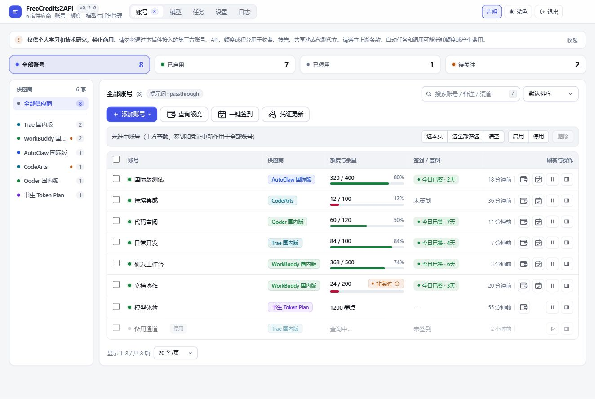

<div align="center">


# FreeCredits2API

[](https://go.dev/)
[](https://github.com/router-for-me/CLIProxyAPI)
[](LICENSE)

[中文](README.md) | English

</div>

FreeCredits2API is a multi-provider plugin for [CLIProxyAPI](https://github.com/router-for-me/CLIProxyAPI) (CPA), with a unified console for accounts, models, quotas, and tasks. It runs as a native shared library and uses the host's API, authentication, and routing.

The project is an independently maintained rework of [cpa-freetier2api-plugin](https://github.com/Likhixang/cpa-freetier2api-plugin).

> **For personal learning and technical research only. No commercial use of connected third-party services or benefits.** Do not use connected accounts, APIs, quotas, credits, or rewards for paid services, resale, paid deployment, reward farming, or public sharing pools. The software is licensed under [MIT](LICENSE); third-party services remain subject to their own terms. See the [disclaimer](#disclaimer).

## Features

- **Unified APIs**: OpenAI Chat Completions, OpenAI Responses, and Anthropic Messages through CPA, with standard and streaming requests.
- **Account management**: OAuth, SMS verification, API keys, and credential import, with account aliases, credential refresh, and batch operations.
- **Model management**: Discovery, enablement, custom aliases, channel tags, and context settings, integrated with CPA routing and failover.
- **Quotas and check-ins**: Account quotas, plans, credits, and check-in history, with operations available according to provider capabilities.
- **Tasks and schedules**: Manual execution, automatic check-in, independent task schedules, background queues, and extensible activity modules.
- **Embedded console**: A web interface for daily administration, runtime settings, and logs.

## Console Preview

The accounts, quotas, and check-in statuses in the screenshot are sample data.



## Supported Providers

Domestic and global editions use separate provider IDs.

| Provider | Provider ID | Authentication |
| --- | --- | --- |
| WorkBuddy | `workbuddycn` / `workbuddyglobal` | OAuth device flow |
| AutoClaw | `autoclawcn` / `autoclawglobal` | SMS verification / OAuth |
| Qoder | `qodercn` / `qoderglobal` | OAuth device flow |
| Qwen Work | `qwenwork` | Web authorization / credential import |
| Raccoon | `raccoon` | OAuth |
| OpenCode ZEN | `opencodezen` | API key |
| Cline | `cline` | Device authorization |
| ZCode | `zcodecn` / `zcodeglobal` | OAuth |
| Trae | `traecn` / `traeglobal` | OAuth |
| CodeArts | `codearts` | OAuth / STS |
| Token Plan | `tokenplan` | API key |
| MiniMax Code | `minimaxcodecn` / `minimaxcodeglobal` | OAuth device flow |

Available models, context capacity, tool calling, quotas, and tasks depend on upstream services and account permissions.

## Installation

Use a CPA build with native shared-library plugin support and enable its plugin and management interfaces. The plugin ID and credential `type` are both `freecredits2api`. The library must match the operating system and architecture of the CPA process.

### Install from the Plugin Store

Open **CPA Admin Panel → Plugin Store**, search for **FreeCredits2API**, and install it. If it is not listed, add this repository's release registry to your existing `plugins.store-sources` list:

```yaml
plugins:
  enabled: true
  store-sources:
    - "https://github.com/UangSC/cpa-freecredits2api-plugin/releases/latest/download/registry.json"
```

The store selects the platform archive and verifies it against `checksums.txt`.

### Manual Installation

Download a matching ZIP from [Releases](https://github.com/UangSC/cpa-freecredits2api-plugin/releases), verify it against `checksums.txt` from the same release, and extract the library into the appropriate directory under `plugins.dir`.

| CPA platform | Path relative to `plugins.dir` |
| --- | --- |
| Linux amd64 | `linux/amd64/freecredits2api.so` |
| Linux arm64 | `linux/arm64/freecredits2api.so` |
| Windows amd64 | `windows/amd64/freecredits2api.dll` |

Check the release page for available platforms. Linux release libraries target glibc 2.17 and require a CPA build with plugin support.

Enable the plugin in the CPA configuration, then reload the configuration or restart the host:

```yaml
plugins:
  enabled: true
  dir: "/path/to/cpa/plugins"
  configs:
    freecredits2api:
      enabled: true
      enabled_realms: "cn,global"
```

## Usage

### Add Accounts

Open the embedded console and sign in with the **CPA management key**. Adjust the host and port for your deployment:

```text
http://localhost:8317/v0/resource/plugins/freecredits2api/console
```

The management key is configured as `management.secret-key` in CPA v8 or `remote-management.secret-key` in legacy configurations.

Click **「添加账号」 (Add Account)**, select a provider, and follow its authorization or credential import flow. Providers with separate balance authorization allow balance credentials to be linked or updated for each account.

On remote hosts, Docker, or WSL, use the authorization dialog's manual callback input if the browser cannot send the callback directly to the plugin.

### Call the API

Use a **CPA client API key** for inference. Query the model list first, then use a returned model ID in your requests:

```bash
export CPA_BASE_URL="http://localhost:8317"
export CPA_API_KEY="your-cpa-api-key"

curl "$CPA_BASE_URL/v1/models" \
  -H "Authorization: Bearer $CPA_API_KEY"
```

The host provides these compatible endpoints:

| Protocol | Endpoint |
| --- | --- |
| OpenAI Chat Completions | `/v1/chat/completions` |
| OpenAI Responses | `/v1/responses` |
| Anthropic Messages | `/v1/messages` |

OpenAI Chat Completions example, with `MODEL_ID` set to an ID from the model list:

```bash
export MODEL_ID="your-model-id"

curl "$CPA_BASE_URL/v1/chat/completions" \
  -H "Content-Type: application/json" \
  -H "Authorization: Bearer $CPA_API_KEY" \
  -d "{\"model\":\"$MODEL_ID\",\"messages\":[{\"role\":\"user\",\"content\":\"Hello!\"}]}"
```

Anthropic Messages example:

```bash
curl "$CPA_BASE_URL/v1/messages" \
  -H "Content-Type: application/json" \
  -H "anthropic-version: 2023-06-01" \
  -H "x-api-key: $CPA_API_KEY" \
  -d "{\"model\":\"$MODEL_ID\",\"max_tokens\":1024,\"messages\":[{\"role\":\"user\",\"content\":\"Hello!\"}]}"
```

Set `"stream": true` in the request body for streaming. For OpenAI-compatible clients, use the CPA `/v1` URL as the base URL and a model ID returned by `/v1/models`.

### Manage Accounts and Models

- **Account aliases**: Click an account name or edit icon to set a display name. Clear it to restore the upstream name.
- **Model aliases**: Edit a model's public ID in the Models table, or clear the alias to restore the default. Case and punctuation are preserved. CPA applies its routing configuration when multiple eligible accounts expose the same ID.
- **Channel tags**: Use `model_name_tag` to add a provider prefix or suffix to models without a manual alias.
- **Context settings**: Editable models accept integer token counts, `400K`, or `1M`. Clear a value to restore automatic settings. Fixed context values are read-only, and upstream capacity limits still apply.

Model changes must be synchronized with CPA's model registry before clients can use them.

### Check-ins and Tasks

The console provides check-in, plan, and task operations according to account capabilities, with manual execution, schedules, and execution history. Automatic check-in and tasks that follow check-in have separate switches; independent tasks use their own schedules. All schedules use the CPA process's time zone.

## Configuration

Configure the plugin under `plugins.configs.freecredits2api` in CPA. Runtime settings saved in the console take precedence over the corresponding YAML settings.

| Key | Default | Description |
| --- | --- | --- |
| `enabled_realms` | `cn,global` | Enabled regions: `cn` and/or `global` |
| `auto_checkin` | `true` | Enable automatic check-in |
| `auto_checkin_at` | `10:00` | Additional check-in time in `HH:MM` format |
| `auto_tasks` | `true` | Run tasks configured to follow check-in; independent tasks use their own schedules |
| `checkin_history_limit` | `30` | Check-in history entries retained per account |
| `model_name_tag` | `off` | Model channel tags: `off` / `prefix` / `suffix` |
| `disabled_models` | empty | Disabled models, using `vendor:model` or the original model name |
| `extra_models` | empty | Additional model names, as a comma-separated value or a list |
| `prompt_mode` | `passthrough` | System prompt handling: passthrough, replace (`custom`), or append (`append`); applies to WorkBuddy |
| `prompt_file` | empty | Custom system prompt file; uses the built-in prompt when omitted |
| `codearts_credit_enabled` | `false` | Enable credit-billed CodeArts inference; no automatic fallback to credits. Refresh models after changing |
| `state_dir` | automatic | Plugin settings, cache, and execution records |
| `log_level` | `info` | Log level: `debug` / `info` / `error` |
| `log_to_file` | `false` | Write daily logs under `<state_dir>/logs/` |
| `log_to_host` | `true` | Write plugin logs to an existing, writable host `main.log` |
| `host_log_file` | empty | Explicit host log path; detected automatically when omitted |
| `host_log_level` | `info` | Minimum level for logs written to the host |

The default check-in schedule includes `09:00` and `21:00`, plus `auto_checkin_at`. Scheduling uses whole hours; times with minutes round up to the next hour.

When `state_dir` is omitted, use `FREECREDITS2API_PLUGIN_HOME` to specify a directory. Legacy state directory environment variables remain supported as fallbacks. Without a directory override, the default is the `freecredits2api` subdirectory of `~/.cli-proxy-api` if that directory exists, or `~/.freecredits2api-plugin`. CPA stores account credentials; the plugin state directory holds settings, caches, and execution records.

## Migration

Back up CPA credentials and plugin state before switching from an older plugin, and disable the old plugin. Reauthorize or explicitly import accounts in the new console. Use separate CPA instances, credential directories, and plugin state directories for parallel deployments.

Batch credential migration requires Python 3.10 or later. Preview the migration plan first, then add `--apply` to create the new credentials. Source files are preserved, and existing target files are skipped.

```bash
python scripts/migrate_auths.py /path/to/old-auths --output-dir /path/to/new-auths
python scripts/migrate_auths.py /path/to/old-auths --output-dir /path/to/new-auths --apply
```

## Development and Build

### Native Build

Use Go 1.22 or later and a C compiler for the target platform.

```bash
git clone https://github.com/UangSC/cpa-freecredits2api-plugin.git
cd cpa-freecredits2api-plugin
```

Linux:

```bash
CGO_ENABLED=1 go build -buildmode=c-shared -trimpath -o dist/freecredits2api.so .
```

Windows PowerShell:

```powershell
$env:CGO_ENABLED = '1'
go build -buildmode=c-shared -trimpath -o dist/freecredits2api.dll .
```

On macOS, use a native C compiler and name the output `freecredits2api.dylib`. Install the resulting library using the platform directory layout above.

### Docker Build

With Bash and Docker available, build the Linux library using the repository script. The output is `dist/freecredits2api.so`:

```bash
./scripts/build.sh
```

### Repository Layout

```text
main.go / cgo.go       Plugin entry points and C ABI
cpasdk/               CPA ABI and API contracts
internal/
  app/                Lifecycle and module composition
  admin/              Management API and embedded console
  auth/               Accounts and login sessions
  core/               Shared provider and task interfaces
  vendors/            Provider protocol adapters
  tasks/              Task scheduling and execution
  taskmods/           Independent activity and task modules
  state/              Plugin state persistence
docs/                 Development documentation and assets
scripts/              Build, packaging, and migration tools
tests/                Integration and UI tests
```

Run `go test ./...` before submitting code. See the [task module guide](docs/TASK_MODULE_GUIDE.md) for activity and task extensions, and the [CPA SDK notes](cpasdk/README.md) for host contracts.

## Feedback and Contributions

Report problems or suggestions through the maintainer's [public contact details](https://github.com/UangSC), and contribute code through pull requests. Include the plugin version, CPA version, platform, and reproduction steps. Remove keys, tokens, and personal information from public logs and screenshots.

## Acknowledgments

- [Likhixang/cpa-freetier2api-plugin](https://github.com/Likhixang/cpa-freetier2api-plugin): Original plugin project.
- [router-for-me/CLIProxyAPI](https://github.com/router-for-me/CLIProxyAPI): Host plugin contracts and API integration.
- [Sliverkiss/workbuddy2api](https://github.com/Sliverkiss/workbuddy2api) and [linguo2625469/workbuddy2api-panel](https://github.com/linguo2625469/workbuddy2api-panel): References for protocol adaptation, prompt handling, and task design.
- [aimod-cc/Agent2API](https://github.com/aimod-cc/Agent2API): References for provider protocols and account capabilities.

## Disclaimer

1. **Personal learning and research only.** Do not use connected third-party accounts, APIs, quotas, credits, or rewards for paid services, resale, paid deployment, reward farming, or public sharing pools. Use, modification, and distribution of the software are governed by the [MIT License](LICENSE); third-party services remain subject to their own terms.
2. **Independent maintenance.** Product names, models, and trademarks belong to their respective owners. Compatibility does not imply affiliation, authorization, or endorsement.
3. **Account authorization.** Use only accounts, credentials, and data that you own or are expressly authorized to use. Follow applicable laws, provider terms, and organizational policies. Do not bypass access controls or upstream usage restrictions.
4. **Automation and charges.** Check-ins, tasks, and credential refresh may change account state. Inference and some tasks may consume quota or credits or incur charges. Confirm permissions and billing rules before enabling these features.
5. **Credentials and data.** Requests may be forwarded to the selected provider. Restrict access to the console and data directories, protect keys and backups, and revoke or rotate exposed credentials promptly.
6. **Availability and reports.** The software is provided as is under [LICENSE](LICENSE). Upstream interfaces, models, and benefits may change. Contact the maintainer through their [public contact details](https://github.com/UangSC) for rights or security reports; send sensitive information privately.

## License

This project uses the [MIT License](LICENSE) and retains the original copyright notice.
